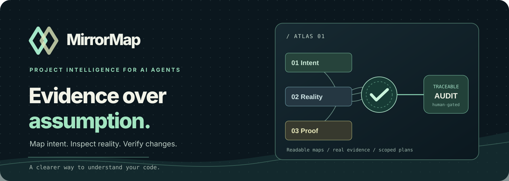
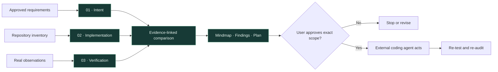

<div align="center">



<br>

**A portable project intelligence skill that separates what you meant, what you built, and what you actually verified.**

[](https://github.com/Guhanavish/mirrormap/actions/workflows/ci.yml)
[](pyproject.toml)
[](LICENSE)
[](CHANGELOG.md)
[](SKILL.md)

[](#get-a-result-in-one-command)
[](docs/getting-started.md)
[](https://guhanavish.vercel.app/)
[](CONTRIBUTING.md)

[**Why it exists**](#why-mirrormap-exists) · [**How it works**](#the-evidence-atlas) · [**Audit modes**](#one-engine-five-views) · [**Integrations**](#meet-your-agent-where-it-works) · [**Roadmap**](#roadmap)

</div>

---

## Why MirrorMap exists

A repository can have a login page and still lack a working login flow. A test can exist without testing the acceptance criteria. And an AI agent can overlook unfinished work because the code itself is the only thing it inspected.

**MirrorMap keeps three kinds of knowledge separate.** It asks what the product promises, what code demonstrably exists, and what independent observations prove—without treating missing search hits as missing features.

| Most code summaries | MirrorMap's approach |
|---|---|
| Tell you what files exist | Link stable requirements to source evidence |
| Treat presence as implementation | Keep tests and acceptance criteria separate |
| Guess missing features | Use `unknown` until scoped absence is reviewed |
| Offer free-form fixes | Produce a review-only, digest-bound plan |
| Depend on one agent | Provide a portable skill, CLI, SDK, and experimental MCP |

## The Evidence Atlas



Every conclusion needs a trail back to source, approved requirements, or verified observations. The pretty mindmap is simply a view of that underlying JSON model.

> [!IMPORTANT]
> **Source scanning is not functional testing.** MirrorMap's core does **not** execute the project's application code, automatically change files, or approve its own remediation. Browser tests and execution require separate host capabilities and permission. v0.2 is a beta, not an exhaustive bug detector.

## Get a result in one command

**Requires Python 3.10+**. The runtime uses the standard library. Run directly from the repository:

```bash
git clone https://github.com/Guhanavish/mirrormap.git
cd mirrormap
python -m projectmirror audit ./examples/demo-app \
  --spec ./examples/demo-app/requirements.md \
  --approved-spec --mode deep
```

The command prints an output directory **outside** the inspected project. Open `dashboard.html` in your browser or inspect the generated reports. `--approved-spec` is for an *actually approved* spec; the bundled fixture intentionally demonstrates one.

| Generated file | What you'll see |
|---|---|
| `dashboard.html` | Responsive, self-contained read-only audit report |
| `audit-report.md` | Classified requirements and rationale |
| `mindmap.mmd` | Mermaid mindmap of findings |
| `candidate-links.json` | Explicitly **unreviewed** possible code matches |
| `remediation-plan.md` | Human-review task proposals; not an execution authorization |
| `audit-manifest.json` | Revision, scope, and known limitations |

Try an inventory without a spec:

```bash
python -m projectmirror audit /path/to/project
```

This is intentionally **structural inventory only**, not a false promise that the tool knows what your app should do.

### An actual demo result

The included intentionally incomplete fixture yields **three `unknown` requirements** when no reviewed implementation links are supplied. That's the correct, conservative answer. See [the worked example](examples/README.md) for importing reviewed links and absence evidence to get a meaningful gap report.

## One engine, five views

| Mode | Main purpose | Example |
|---|---|---|
| **Quick** | Lightweight source inventory | `--mode quick` |
| **Deep** | Requirements, candidate links, validated evidence | `--mode deep --spec docs/requirements.md` |
| **PR** | Git changed-file context plus audit | `--mode pr --base origin/main` |
| **Drift** | Compare classifications to a prior baseline | `--mode drift --baseline /tmp/prior-audit` |
| **Visual** | Import host-collected visual verification where available | `--mode visual --verification tests-evidence.json` |

The modes share the same evidence rules. **PR mode does not automatically prove regression impact, and Visual mode does not launch a browser by itself.** [Understand every mode and limitation](docs/guides/audit-modes.md).

## Meet your agent where it works

<div align="center">
<table>
<tr><td width="50%"><b>🧠 Agent Skill</b><br>Use <a href="SKILL.md">SKILL.md</a> with Agent Skills-compatible clients; preview installation before copying files.</td><td width="50%"><b>⌨️ CLI</b><br><code>python -m projectmirror audit ...</code> for repeatable inspection and offline reports.</td></tr>
<tr><td><b>🔌 Local MCP (experimental)</b><br>Three allowlisted, read-only tools exposed via stdio JSON-RPC. <a href="docs/integrations/mcp.md">Setup and limits</a>.</td><td><b>🐍 Python API</b><br><code>from projectmirror.experience import audit_project</code> for custom workflows. <a href="docs/integrations/python-api.md">Examples</a>.</td></tr>
<tr><td><b>⚙️ GitHub Actions example</b><br>Generate artifact reports on pull requests; no auto-fixes. <a href="examples/github-actions/README.md">See workflow</a>.</td><td><b>🗺 Offline dashboard</b><br>Self-contained HTML report, generated with the audit. No hosted account needed.</td></tr>
</table>
</div>

**Check your setup:**

```bash
python -m projectmirror doctor
```

**Install the skill into your agent's configured skills folder** (this is a preview first):

```bash
python -m projectmirror install-skill --dest ~/.codex/skills/mirrormap
python -m projectmirror install-skill --dest ~/.codex/skills/mirrormap --apply
```

For Claude Code, replace the destination with its skills folder; never overwrite an existing install automatically. The installation script copies the portable skill and core to the requested destination and doesn't modify global agent configuration. For [skills.sh](https://skills.sh/) users, the external CLI may also support `npx skills add Guhanavish/mirrormap`; installation in specific agents should be verified rather than assumed.

[**Install & setup guide**](docs/getting-started.md) · [**Agent integration patterns**](docs/integrations/agent-guides.md) · [**MCP contract**](docs/integrations/mcp.md)

## The safety contract

- **Intent is independent:** code cannot quietly rewrite requirements.
- **Unverified means unverified:** a file exists ≠ a feature passes tests.
- **Candidate matches never become reviewed evidence automatically.**
- **No edits on audit:** report artifacts are outside the source repository.
- **Human-approved remediation:** generated plans do not authorize themselves; the host controls code changes.
- **Stale evidence doesn't count:** `complete` requires revision-matched verification for acceptance criteria.
- **Honest errors:** missing specs, inaccessible tools and uncertainty are surfaced as limitations.

Read [SECURITY.md](SECURITY.md) and [the evidence model](references/data-model.md).

## Build with us

The project welcomes reproducible reports, language-specific scanners, meaningful CI examples, and integration testing. If you propose a new agent adapter, verify the exact install path and tool capabilities first.

[Report a bug](https://github.com/Guhanavish/mirrormap/issues/new) · [Contribute](CONTRIBUTING.md) · [Engineering standard](docs/IMPLEMENTATION_STANDARD.md) · [Changelog](CHANGELOG.md)

## Roadmap

- [x] **v0.1 Foundation:** independent maps, structural indexing, evidence-aware diff and reviewed plans.
- [x] **v0.2 Evidence Atlas:** one-command audit, offline dashboard, five scoped modes, doctor, installer, candidate links, baseline comparison, Python API, experimental MCP and CI example.
- [ ] **v0.3 Rich evidence:** framework-specific adapters, stronger AST and test/coverage imports, automatic safe link-review UX.
- [ ] **v0.4 Connected workflows:** validated cross-agent installers, reproducible browser adapter, advanced PR impact and CI annotations.
- [ ] **v1.0 Interactive review:** hosted docs/demo, approved-change interface, evaluations and verified plugin distribution.

The live, interactive dashboard, fully automatic bug detection, agent-host approvals and hosted demo are **not** part of the v0.2 release. Read the [release notes](docs/release-notes-v0.2.md) for exact scope.

---

<div align="center">

### **Know what your software promises. Prove what it delivers.**

Made for the open agent ecosystem · MIT licensed · [Creator's website](https://guhanavish.vercel.app/)

**If MirrorMap saves you an audit, consider starring the repo.**

</div>
