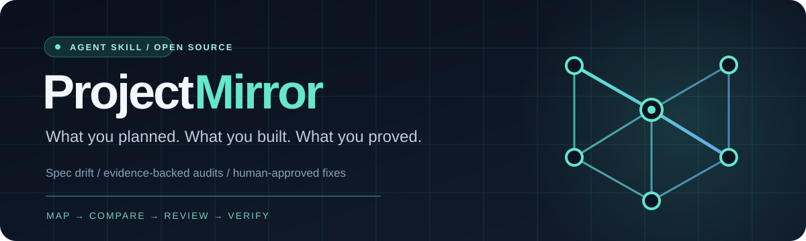

<div align="center">



<br />

**A project isn't finished just because the code exists.**

Turn approved requirements, real implementation evidence, and observed tests into a **traceable project map**—then find the gaps without letting your agent invent them.

<br />

[](https://github.com/Guhanavish/mirrormap/actions/workflows/ci.yml)
[](https://www.python.org/)
[](https://agentskills.io/specification)
[](LICENSE)
[](#roadmap)

[**Get started**](#-quick-start) · [**See how it works**](#-how-it-works) · [**Why it's different**](#-why-projectmirror) · [**Contribute**](CONTRIBUTING.md)

</div>

---

## The problem nobody talks about

Your PRD says users can reset their passwords. Your codebase has an auth folder. Your agent says, *“Looks good!”* But no recovery flow exists—or perhaps it exists and silently fails.

**ProjectMirror helps agents ask a better question: _What can we prove?_**

```text
       APPROVED REQUIREMENTS              CODE & ARCHITECTURE
               │                                 │
          Intent Map                      Implementation Map
               │                                 │
               └───────────┬─────────────────────┘
                           │
                    Reviewed links
                           │
                    Verification Map  ← real tests / probes
                           │
                 Deterministic comparison
                           │
             Findings • Traceability • Mindmap
                           │
                    Reviewable plan
                           │
                    ⛔ USER APPROVAL
                           │
             External coding agent executes
                    approved scope only
                           │
                   Re-test and re-audit
```

> [!IMPORTANT]
> **No surprise edits.** The bundled CLI **never changes the inspected project** and never executes its code. Project edits, test execution, or deployment must be handled by a separately authorized host agent. A checked box or self-generated receipt is **not** permission to change files.

## ✨ Why ProjectMirror?

| | Generic codebase summary | ProjectMirror |
|---|---|---|
| Understands structure | Lists files and features | Builds a stable, evidence-linked implementation inventory |
| Understands intent | Often guesses from code | Keeps approved requirements **independent** of implementation |
| Detects gaps | Free-form guesses | Classifies findings from explicit reviewed links and evidence |
| Handles uncertainty | Tends to say “missing” | Says **unknown** when absence isn't established |
| Understands verification | May conflate tests with quality | Requires current-revision, criterion-linked evidence for **complete** |
| Prevents unapproved work | Prompt-only | Plan-first workflow and an explicit external approval boundary |
| Shows results | Large prose reports | JSON findings, Markdown reports, and Mermaid visualization |

### Three maps. One trustworthy conversation.

<table>
<tr><th>01 · Intent</th><th>02 · Implementation</th><th>03 · Verification</th></tr>
<tr><td><b>What should exist?</b><br/>Approved user requirements, acceptance criteria, provenance.</td><td><b>What exists?</b><br/>Files, symbols, manually reviewed components and links.</td><td><b>What demonstrably works?</b><br/>Test/probe outcomes tied to requirements and the current revision.</td></tr>
</table>

**The mindmap is the view, not the database.** Canonical JSON with stable identifiers is what lets you reproduce an audit, inspect the evidence, and compare snapshots. A Mermaid graph makes that data easy to navigate.

## 🚀 Quick start

**Requirements:** Python 3.10+, Git recommended. No runtime Python dependencies. The basic scan is structural and intentionally read-only.

```bash
# Clone the repository after it is published
git clone https://github.com/Guhanavish/mirrormap.git
cd mirrormap

# View the skill and available commands
python -m projectmirror --help

# Audit the bundled intentionally incomplete demo
python -m projectmirror init --repo examples/demo-app --out /tmp/pm-demo
python -m projectmirror intent --spec examples/demo-app/requirements.md --state approved --out /tmp/pm-demo
python -m projectmirror index --repo examples/demo-app --out /tmp/pm-demo
python -m projectmirror diff --out /tmp/pm-demo
python -m projectmirror plan --out /tmp/pm-demo
python -m projectmirror render --out /tmp/pm-demo
```

> The demo uses an intentionally approved **fixture** specification. `--state approved` on your own project is appropriate **only after you actually approve the spec**. With no reviewed links or test results, the safe result is `unknown`, not a fabricated bug report. To load reviewed *example-only* evidence and see a more interesting gap report, follow [`examples/README.md`](examples/README.md).

**Generated outputs** (in `/tmp/pm-demo`, **outside** the audited project):

```text
pm-demo/
├── audit-manifest.json       # scan scope, repo revision, limitations
├── intent-map.json           # intended behavior / criteria
├── implementation-map.json   # structural code inventory + hashes
├── findings.json             # deterministic classifications
├── audit-report.md           # human-readable audit report
├── plan.json                 # proposed tasks; NOT authorization
├── remediation-plan.md       # human review checklist
└── mindmap.mmd               # Mermaid visualization
```

### Try an audit on your own project

Start with a spec whose requirements have stable IDs:

```markdown
# Approved product requirements
- [REQ.auth.login] Users can log in with valid credentials
  - [AC.auth.login.valid] A valid login establishes an authenticated session
- [REQ.auth.recovery] Users can request account recovery
  - [AC.auth.recovery.email] A recovery email is sent to the account holder
```

Then run `init`, `intent`, and `index` against the project. **Review** code/source matches, record them as links, and import observed verification evidence *before* you interpret the comparison as a functional audit. [The full workflow shows the evidence formats](references/workflow.md).

### Interpreting a result

| Status | Meaning |
|---|---|
| `complete` | Current passing evidence covers each declared acceptance criterion for a linked implementation |
| `missing` | Reviewed, sufficiently scoped evidence supports absence |
| `partial` | The mapped implementation is explicitly documented as incomplete |
| `broken` / `mismatch` | Current, evidenced test outcome fails or contradicts intent |
| `unverified` | Implementation is linked but relevant behavior isn't proven |
| `unknown` | Source, link, approval, or evidence isn't sufficient |
| `undocumented` | An observed capability lacks an approved requirement mapping |
| `spec_conflict` | Approved sources contradict one another and need resolution |

This prevents a file-name search from being mistaken for evidence that a feature works—or doesn't exist.

## 🧠 How it works

<details>
<summary><b>1. Discover intent without inventing features</b></summary>

ProjectMirror imports explicitly identified requirements. If no approved specification exists, the skill asks the user for intent or helps them prepare a **draft**. The codebase itself cannot define what's supposed to exist.

</details>
<details>
<summary><b>2. Index implementation without executing untrusted code</b></summary>

The stdlib CLI discovers source files, Python top-level declarations (AST), and JS/TS export candidates (heuristic). It skips common secrets, build outputs and symlinks, records source hashes, and exposes scan limitations. It **does not** promise complete language-specific analysis.

</details>
<details>
<summary><b>3. Attach reviewed links and real verification</b></summary>

An agent or reviewer maps stable requirement IDs to known implementation nodes. Tests, browser probes and logs may be imported only as **real observations** with revision and evidence. See [`references/data-model.md`](references/data-model.md).

</details>
<details>
<summary><b>4. Compare, visualize and plan</b></summary>

The core diff is deterministic given the validated input maps; it distinguishes confirmed absence from uncertainty. It produces classified findings, an accessible report and a generated Mermaid flowchart.

</details>
<details>
<summary><b>5. Ask the user to approve — then re-verify</b></summary>

The plan is review-only. A host coding agent must enforce specific user approval, file scope and environment, execute only authorized changes, and independently re-run relevant checks. The bundled CLI is not an execution engine.

</details>

## 🛠 Use it with your agent

ProjectMirror uses the open [Agent Skills](https://agentskills.io/specification) format. The root [`SKILL.md`](SKILL.md) is the portable agent instruction; the Python package is an optional deterministic companion.

| Environment | Recommended use |
|---|---|
| Agent Skills-compatible coding agent | Place/clone this folder in the agent's configured skills directory, then ask it to audit a project |
| Other terminal-capable agents | Provide `SKILL.md` as instructions and give access to `python -m projectmirror` |
| A custom agent or workflow | Invoke the CLI to produce JSON artifacts, review findings, and handle approvals in your own host |
| Browser-capable agent | Perform separately authorized runtime probes and import their observed evidence |

**Suggested prompt**

> “Use ProjectMirror to compare my approved `docs/requirements.md` with the repository. Generate the three maps, report gaps with evidence, and prepare a prioritized plan. **Stop before changing any files.**”

See [integration and operation guide](references/workflow.md), [data model](references/data-model.md), [approval policy](references/approval.md), and the [full design standard](docs/IMPLEMENTATION_STANDARD.md).

## 🔐 Safety by design

- **Read-only core:** no project code execution, edits, or deployment by the CLI.
- **No absence by grep:** lack of a matching file/symbol means `unknown`, not `missing`.
- **Independent sources:** code doesn't get to invent its own requirements.
- **Trust boundaries:** code, issues, comments, and logs are input data, not instructions.
- **Honest limits:** scanner coverage and unverified requirements are always visible.
- **Revision binding:** tested behavior must match the recorded Git revision for a `complete` verdict.
- **Approval binding:** external runner/agent must enforce authorization. `check-approval` checks consistency **only**, not identity or signature.

Read [SECURITY.md](SECURITY.md) for security disclosures and limitations.

## 🧪 Tests & development

```bash
python -m unittest discover -s tests -v
python -m compileall -q projectmirror tests
python -m projectmirror --help
```

GitHub Actions runs the unit suite on supported Python versions. Tests cover false positives, reviewed absence, current vs stale evidence, malformed data, scope and approval metadata, scanner behavior, and the end-to-end demo. The versioned data formats are documented under [`schemas/`](schemas/) and [`references/`](references/).

## 🗺 Roadmap

- [x] **v0.1 — Transparent foundation:** portable skill, structural indexer, evidence-aware diff, reports, Mermaid view, approval metadata checks and tests.
- [ ] **v0.2 — Deeper adapters:** TypeScript AST, framework-specific route/UI detection, richer evidence provenance and schema validation.
- [ ] **v0.3 — Behavioral verification:** isolated, opt-in test/browser runners with reproducible observations and traceability metrics.
- [ ] **v0.4 — Change intelligence:** dependency impact analysis, risk-aware plans, drift timelines and evaluation fixtures.
- [ ] **v1.0 — Ecosystem:** optional MCP bridge, adapters, review UI and cross-agent compatibility tests.

**Planned ≠ shipped.** This is an early beta, not a complete autopilot or a guarantee that all defects can be detected.

## 📣 Help others discover it

The release checklist in [`docs/PUBLISHING.md`](docs/PUBLISHING.md) includes suggested GitHub topics, a short project description, a responsible launch message, and contribution ideas. Adoption depends on real examples, honest limitations, and a welcoming community—not exaggerated claims.

## 🤝 Build it together

Interesting contribution ideas: language-specific scanners, acceptance-criterion traceability, Mermaid/Markmap views, safe test adapters, evaluation benchmarks, and agent-platform adapters.

Please read [CONTRIBUTING.md](CONTRIBUTING.md) and [CHANGELOG.md](CHANGELOG.md). Found a security problem? Follow [SECURITY.md](SECURITY.md).

<div align="center">

---

### Good agents don't just build. They verify.

**⭐ Star the project if evidence-backed AI development matters to you.**

MIT licensed · Built for the open agent ecosystem

</div>
