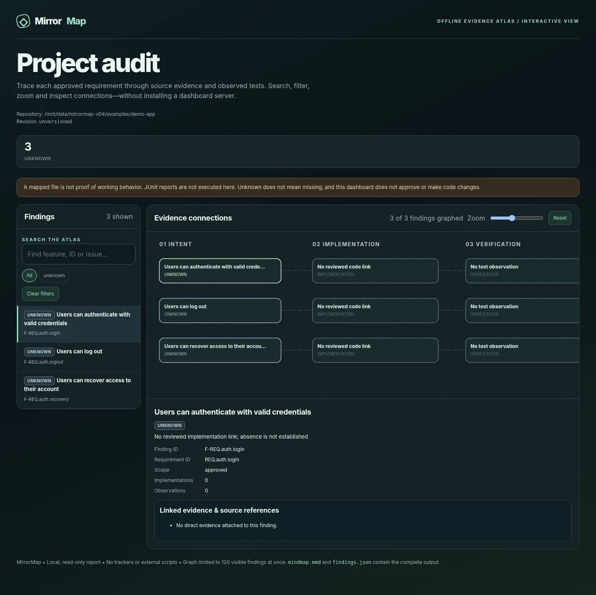

# First audit walkthrough: unknown is not missing

**Time:** about two minutes after cloning the repository. This is a reproducible **demonstration fixture**, not an audit of a production application.

MirrorMap separates three questions: what a project is expected to do, what source code appears to implement, and which behaviors have been independently verified. It will not infer that a feature is missing solely because a file or symbol search returned no match.

## 1. Start from the repository root

Requires Python 3.10 or newer. No application dependencies or network access are needed to run this example.

```bash
git clone https://github.com/Guhanavish/mirrormap.git
cd mirrormap
python -m projectmirror doctor
```

On Windows, run the equivalent commands in PowerShell and use `py -m projectmirror` if `python` is not on your PATH. MirrorMap writes reports to separate temporary folders unless an external `--out` directory is specified.

## 2. Audit the example without reviewed links

```bash
python -m projectmirror audit examples/demo-app \
  --spec examples/demo-app/requirements.md \
  --approved-spec --mode deep
```

**Expected classification summary:** `{"unknown": 3}`.

Why? The sample specification declares login, logout, and account recovery. The code scanner can inventory `auth.py`, but an inventory does not establish which code meets the approved requirements. No reviewed requirement-to-implementation links were provided.

- `REQ.auth.login` — **unknown**, because there is no reviewed implementation mapping or relevant current verification evidence.
- `REQ.auth.logout` — **unknown**, for the same reason.
- `REQ.auth.recovery` — **unknown**, because a scanner's inability to find it is not proof of exhaustive absence.

> **Approval note:** `--approved-spec` is valid here only because `examples/demo-app/requirements.md` is a deliberately prepared, approved example fixture. On your own project, do not pass that flag until an actual person with authority has reviewed the specification.

The CLI prints an absolute output folder. Open its `dashboard.html` locally to view the searchable Evidence Atlas. Also inspect `audit-report.md`, `candidate-links.json` (unreviewed hints), and `remediation-plan.md` (not permission to edit anything).



*This image comes from the bundled demo, not an external production application. A visible node or source file does not imply a working feature.*

## 3. Repeat with reviewed **sample** evidence

```bash
python -m projectmirror audit examples/demo-app \
  --spec examples/demo-app/requirements.md \
  --approved-spec --mode deep \
  --links examples/fixture-reviewed-links.json \
  --absence examples/fixture-reviewed-absence.json
```

**Expected classification summary:** `{"missing": 1, "unverified": 2}`.

| Requirement | Classification | Evidence and explanation |
|---|---|---|
| `REQ.auth.login` | `unverified` | The fixture links login to an implementation candidate, but supplies no current passing authentication test. |
| `REQ.auth.logout` | `unverified` | A logout function is linked, but the fixture has no observed session-clearing test. |
| `REQ.auth.recovery` | `missing` | This **specific tiny fixture** includes an explicit reviewer-approved exhaustive absence record for recovery. |

The second command creates a separate report directory; compare both outputs. Neither command runs application code, sends project files to an external service, edits the repository, or implements a remediation plan.

**What the classifications do not mean:** `missing` here does not generalize to other repositories; `unverified` does not mean passing or failing; `unknown` is not a defect. The bundled authentication code is intentionally incomplete and must never be used for real logins.

## 4. How to interpret your own results

1. Begin with a real, independently approved specification and check requirement IDs and acceptance criteria.
2. Review proposed `candidate-links.json` associations against source before importing links; keyword similarity alone is not enough.
3. Import only authentic tests, logs, or browser observations with matching revision and acceptance criteria. A recorded pass without a reviewed mapping does not prove feature completion.
4. Confirm an absence only after a suitably scoped, reviewed inspection. Missing grep hits are not sufficient.
5. Read the plan and explicitly approve each change before allowing any external coding agent to edit source.

See [full audit workflow](../../references/workflow.md), [verification evidence](junit-evidence.md), [the interactive dashboard](interactive-atlas.md), and [the short video storyboard](../launch/demo-script.md).

## Reproducibility check

The repository has an automated end-to-end test that executes the two commands against this same example and asserts **3 unknown** first, then **1 missing and 2 unverified**. This detects accidental regressions in the demo's claims.
